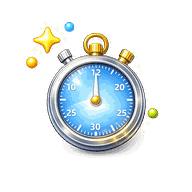
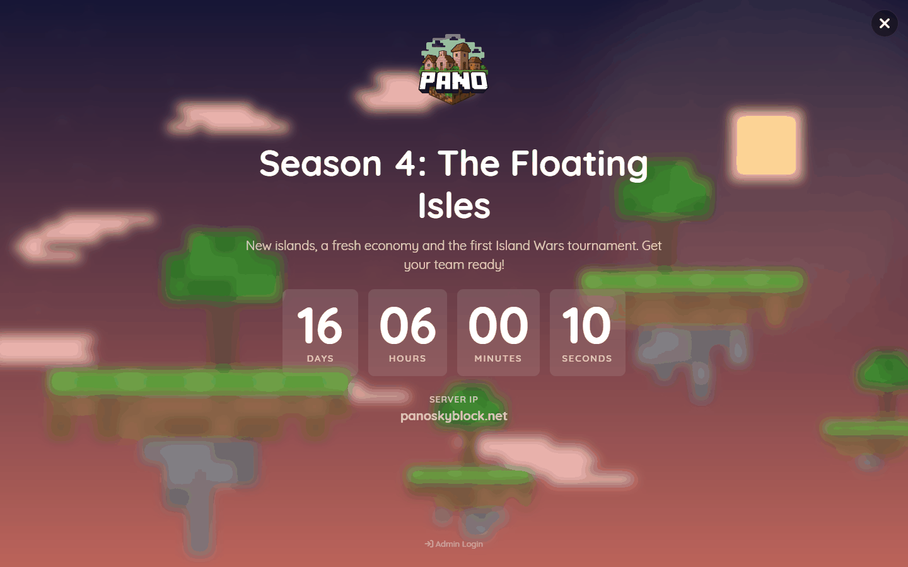
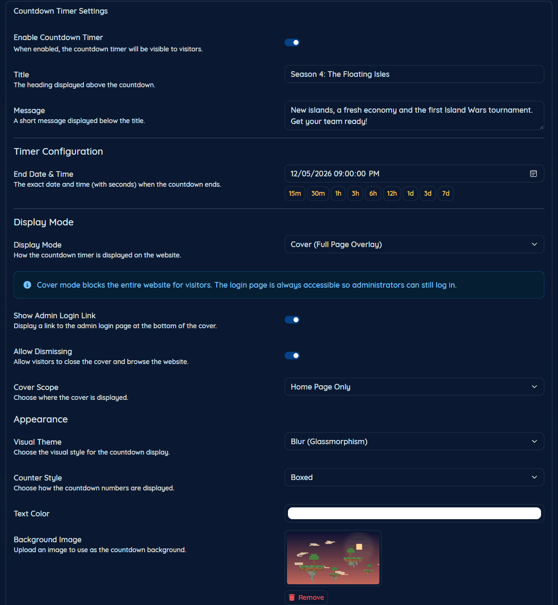

  
  <h1>Countdown Timer</h1>
  
<b>Build hype for your launch with a live countdown your players can't miss.</b>

  

    
    
    
  

Countdown Timer shows a live countdown to your next big moment, like a server launch, a new season or an event. Show it as a full-screen cover, on its own page or as a small box on your home page. When the time is up, it hides by itself and your website is back to normal.

<h3 align="center">Features</h3>

- ⏳ **Live countdown**: Days, hours, minutes and seconds tick down in real time.
- 🖥️ **Three ways to show it**: A full-screen cover, its own page or a box on your home page.
- 🎨 **Five looks**: Dark, light, blur, minimal or gradient, plus five counter styles.
- 🖼️ **Your own background**: Upload an image and add your logo and server address.
- 🎆 **Opening effects**: Celebrate with confetti, fireworks or sparkles when time runs out.
- 🔓 **Opens by itself**: When the countdown ends, the cover hides and your site is open again.
- 🔑 **Admins stay in**: The login page always works, and visitors can be allowed to skip the cover.

<h3 align="center">Screenshots</h3>

<i>Or show it as a small countdown box on your home page.</i>

<i>Set the date, display mode and look from the panel.</i>

<h3 align="center">Get started</h3>

1. Open your Pano panel and go to **Addons**.
2. Find **Countdown Timer** and click **Install**.
3. Open the addon's **Settings** tab, pick your end date and display mode, switch it on and click **Save**.

<h3 align="center">Support</h3>

Questions or ideas? Join our [Discord](https://panomc.com/discord) or visit [panomc.com](https://panomc.com).

<h3 align="center">License</h3>

Released under the MIT License.
